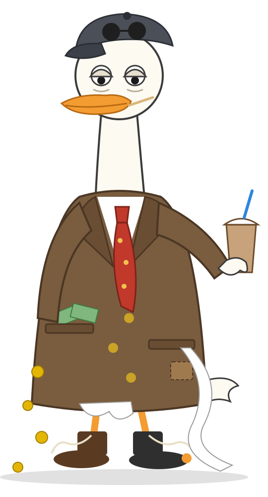

<p align="center">
  
</p>

<h1 align="center">🦆 Duck Run</h1>

<p align="center"><b>Two buttons. A whole room of players. One duck in debt to the mafia.</b><br>
A 3D browser game for the JPMorgan Chase challenge: <i>make something fun that uses two buttons or actions maximum.</i></p>

<p align="center"><b>▶ Play now: <a href="https://duck-run-lac.vercel.app">duck-run-lac.vercel.app</a></b><br>
<a href="https://github.com/Tejas-kaushik/duck-run/actions/workflows/ci.yml"></a></p>

> **A team project.** Built by Team 46 (five of us) at GUTS 2026 for the JPMorgan Chase challenge. This is my copy for my portfolio; the original repository, with the full commit history from everyone, is [zubmoh57/DYHTG-2026](https://github.com/zubmoh57/DYHTG-2026). Who built what is [below](#team-46-aka-team-monster).
>
> **My part (Tejas Kaushik):** integrating everyone's work into one game, the 3D rendering (Bill, the stages and the Don), the pond lobby, the multiplayer races, the big-screen spectator mode and the phone controls.

---

## The pitch

Bill the duck borrowed breadcrumbs from **Don Crumbs**, a mafia pigeon charging 400% a week. Now he has to run for it: down a muddy forest road with the Don's dog on his tail, into a pond full of coins, back up the road, and finally face the Don himself.

Duck Run is built around one rule: **every decision in the game is left or right.** Two buttons, nothing else, from the first lane change to the final shot at the boss.

And it's built to be played **together, in the room**. The host puts the game on a big screen, everyone scans a QR code, and within seconds the whole room is racing on their phones while the projector shows every duck on one track, live commentary and a podium at the end.

## Two buttons, really

| | Left button | Right button |
|---|---|---|
| **Laptop** | `A` | `D` |
| **Phone** | tap the left half of the screen | tap the right half of the screen |

- **Dodging** (forest road, pond): left and right change lane.
- **Boss fight:** when **FIRE** flashes, press **either** button as fast as you can. Faster = more damage. Too early, or holding a button through FIRE, does almost nothing.
- **Cards and cutscenes:** either button continues.

There is no third key. Because any two buttons will do, the game also works one-handed, with two thumbs, or with two accessibility switches.

## Play together

1. **Host:** open the game on the laptop connected to the projector → *Create room*. You land in the **pond lobby**, where every player floats as a Bill in their own coloured suit.
2. **Everyone else:** scan the **QR code** on screen, type a name, tap *Jump in*. Your duck splashes into the pond.
3. **Host:** switch on **📺 Big-screen mode** so the projector watches instead of playing, then press **Start race**.
4. The first race opens with the **story**, playing on every screen at once, then everyone starts together on the **same course** (each room has its own seed) on their own phone. Rematches skip the story: a quick *ROUND 2* card and you're off.
5. The **big screen** shows every duck moving along one track, a live clock and commentary: *"Mayank dives into the pond!"*, *"Don Crumbs got Rayyan!"*, *"Vansh takes the lead!"*.
6. When everyone has finished or been knocked out, a **podium** rises with confetti, and the Don roasts whoever came last.
7. Everyone heads **back to the pond**, and the host can start the next race. New players can scan in between races.

Prefer to play alone? **Solo practice** opens with the story as a short animated film, then plays the same run.

## How a run plays (about 1½ minutes)

| | What happens | Time |
|---|---|---|
| **Stage 1 · Forest road** | Dodge fallen logs in three lanes. Hit one and the Don's dog catches up; hit another while it's close and it bites. | ~20 s |
| **Into the pond** | A pond appears in the road; Bill dives in. | |
| **Underwater** | Collect coins and dodge jellyfish and pufferfish. Coins buy a power-up for later: **20** = shield, **50** = speed boost, **100** = laser +50%. | ~15 s |
| **Back to the surface** | Bill's eyes turn to dollar signs; he grabs a dollar on a fishing line and gets yanked back up. | |
| **Stage 2 · Back on the road** | Faster now. Breadcrumbs are worth **5,000** points each, and a heart gives an extra life. | ~15 s |
| **Boss · Don Crumbs** | Dodge three aimed shots, then *Ready… Aim… FIRE!* Hit the button fast to laser the Don. Repeat until one of you goes down. | |

You have 3 lives. The **score** rewards how far you got, coins and breadcrumbs. Beating the Don adds a big bonus, plus extra for every second under two minutes and every life left, so any win outranks any run that didn't make it. Each stage starts with a short card explaining what to do.

## Run it yourself

You need **Node 20.19+**.

```bash
cd client
npm install
npm run dev
```

Open **http://localhost:5173**. The dev server also listens on your Wi-Fi: phones on the same network can open the **Network** address it prints, or just scan the QR code in a room.

### Online rooms (phones on different devices)

Rooms run on [Supabase](https://supabase.com). Without the two keys below, the game quietly uses **offline test rooms**, which work between tabs of the same browser.

1. Create a Supabase project and turn on **Allow anonymous sign-ins** in its Authentication settings.
2. In the **SQL Editor**, run the files in `supabase/migrations/` in order. For a project that already has the first one, `supabase/apply_to_live.sql` brings it up to date and is safe to run again.
3. Create `client/.env.local` (it's gitignored):

   ```
   VITE_SUPABASE_URL=https://<your-project>.supabase.co
   VITE_SUPABASE_ANON_KEY=sb_publishable_...
   ```

   Use the **publishable (anon)** key, never the secret one. The game refuses to start with a secret key.

### Scripts (in `client/`)

| Command | Does |
|---|---|
| `npm run dev` | Dev server with hot reload |
| `npm test` | 150+ unit tests (Vitest) |
| `npm run typecheck` | TypeScript check |
| `npm run build` | Typecheck, then a production build in `client/dist` |
| `npm run character` | Bill's character preview page |

The database's security rules have their own suite: `supabase/tests/rls_test.sh` (60 checks; see the file for setup).

### Handy URLs

| Add to the URL | Effect |
|---|---|
| `?room=QUAK` | Join screen for room QUAK (what the QR codes open) |
| `?local` | Force offline test rooms, even with Supabase keys |
| `?touch` | Show the phone controls on a laptop |
| `?short` | Every stage at a fifth of its length, for quick testing (`npm run dev` only) |
| `?phase=boss` | Jump straight to a stage: `runner1`, `swim`, `runner2`, `boss`… (`npm run dev` only) |
| `?quality=low` | Pin the graphics quality (`high`, `medium`, `low`); otherwise it adapts to the device |

## How it's built

- **TypeScript + [Three.js](https://threejs.org)**: one game loop and one renderer with bloom, soft shadows and tone mapping. Every model and texture is made in code: no downloaded assets.
- **A state machine** runs the stages (Stage 1 → dive → underwater → surface → Stage 2 → boss), and **one input router** is the only thing that reads the keyboard or the screen halves. That's how the two-button rule is enforced in one place.
- **Seeded courses:** a room's seed builds the same logs, coins and creatures for everyone, and every course is checked to always have a way through.
- **[Supabase](https://supabase.com)** for rooms: anonymous sign-in, Postgres with row-level security (players can only write their own runs), Realtime for live updates, and a server clock so everyone starts on the same beat.
- **Phones:** two-half touch controls, zoom locked, and graphics quality that adapts to keep the frame rate up.
- **Sound** is synthesised live with the Web Audio API: the music and every effect, with no audio files.
- **Tested:** 150+ unit tests across game rules, input, courses, rooms, ranking and the big screen, plus 60 database security checks. GitHub Actions runs the tests and the build on every push to `main` and `dev`.

```
client/src/
  core/      game loop, state machine, input, run state and scoring
  phases/    each stage: runner, transitions, underwater, boss
  render/    Bill, the forest road, pond, sky, effects, render pipeline
  course/    seeded course generator
  sim/       boss rules (pure logic)
  network/   rooms: offline test rooms and Supabase, ranking, live scoreboard
  ui/        lobby and pond, big screen, HUD, results, story, phone controls
  audio/     synthesised music and sound
supabase/    database migrations, the live update script, security tests
docs/        design docs (start with DESIGN_CHANGES.md)
```

## AI usage

**We designed Duck Run ourselves: the characters, the story, every stage and the rules were drawn on paper before any code was written. We built it with AI-assisted development (Claude Code and Codex): we decided what to build, directed the AI, integrated everyone’s work into one game and play-tested it throughout on laptops and phones..

Our presentation is in [docs/duck-run-judges-deck.pptx](docs/duck-run-judges-deck.pptx).

## Team 46 (aka Team Monster)

| | |
|---|---|
| **Tejas Kaushik** | Integration, 3D rendering (Bill, the stages, the Don), lobby and pond, multiplayer races, big-screen mode, phone controls |
| **Mayank Mishra** | Supabase backend: schema, security rules and tests, rooms, ranking and the live scoreboard |
| **Mohammad Rayyan Adhoni** | Seeded course generator and room integration |
| **Zubair Mohammed** | Boss rules and reaction timing, stage instruction cards |
| **Vansh Ravibhai Thacker** | Sound and music, the story intro and ending films, render quality on slower devices, tests |

---

<details>
<summary><b>Design docs from the hackathon</b></summary>

- [Design changes](docs/DESIGN_CHANGES.md): the final rules and everything decided since the brief. Start here.
- [Game brief](docs/GAME_BRIEF.md), [additional info](ADDITIONAL_INFO.md), [team split](docs/TEAM_SPLIT.md), [backend notes](docs/MAYANK_BACKEND.md), [Bill the duck](docs/character/CHARACTER.md).

</details>
